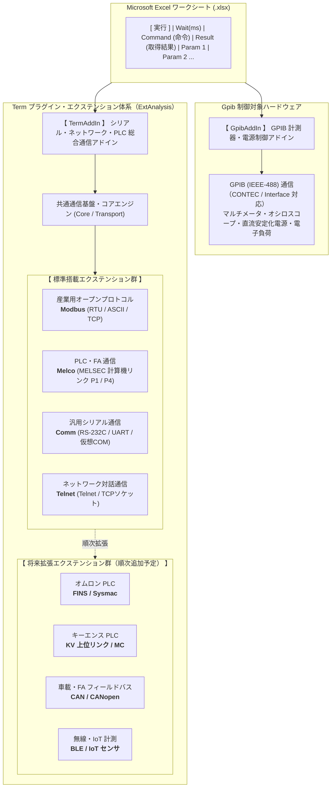



# Monacaアプリ工房 (Monaca App Store)

---

## 💡 Monacaアプリ工房とは？

> **Excel を、すべての計測・制御・自動化の統合コンソールへ。**  
> 使い慣れた Excel のシート上に手順を記述するだけで、様々なデバイスや計測器をダイレクトにコントロールできる次世代 Excel VSTO アドインシリーズです。

**Monacaアプリ工房** は、工場の自動検査、実験室での特性評価、研究開発におけるデータ収集を「誰もが簡単に・素早く」自動化できるように設計された計測制御ソリューションです。なお、工房名およびブランド名である「 **Monaca** 」は、当工房のマスコットキャラクター（チワワ）に由来します。

VBA マクロのプログラミングや専用ツールの複雑な学習は一切不要です。最大の特徴は、 **マクロ有効ブック（`.xlsm`）ではなく、安全な標準ファイル形式（`.xlsx`）のままでシーケンス実行ボタンを配置・保存・動作できる** こと。企業の厳しいマクロセキュリティ警告や実行ブロックを完全に回避しながら、 **Excel シートのセルにコマンドやパラメータを書き込み、ボタンを押すだけ** で、各種ハードウェアとの通信から測定値のリアルタイム自動集計までをセキュアに実行できます。

---

## ✨ シリーズ共通のコア特長

1. **VBAマクロ完全不要・標準 `.xlsx` 形式での完全動作（革新的セキュリティ）**
   * シート上の「実行」ボタンや「一括実行（Start）」ボタンは、アドイン（VSTO）が動的にイベントをバインドして制御します。
   * ワークブック内に VBA マクロコードを一切埋め込まないため、 **標準の `.xlsx`（マクロ無効ブック）形式のままで保存・配布・実行が可能** です。
   * 昨今の Windows / Excel 環境で厳格化されている「マクロセキュリティ警告」「マクロの無効化ブロック（MOTW / Mark of the Web）」を完全にクリアし、社内ネットワークや現場でも安心してシートを共有・運用できます。
2. **セル直結型シーケンス制御**
   * シート上の指定セルを起点として、実行ボタン・待機時間・コマンド・結果・パラメータ枠をワンクリックで自動生成。
   * 個別ステップの「単発実行」と、上から順に一気に流す「一括連続実行（Start）」を直感的に使い分けられます。
3. **測定データのリアルタイム・自動セル展開**
   * 機器から取得したデータは指定の結果セルへ即座に書き込み。波形データや多点計測値などの二次元配列データも、セル範囲へ自動展開されます。
4. **入力規則（ドロップダウン）の自動連動**
   * コマンド定義に設定された選択肢（レンジ設定や測定モード等）が、Excel の「データの入力規則」としてセルへ自動適用され、入力ミスを防ぎます。
5. **お好みスタイルの保存＆テンプレート化**
   * セルの背景色、罫線、フォント、列幅などをカスタマイズした上で「スタイル保存」を行えば、次回以降も自社標準のデザインでシーケンスを作成できます。
6. **統一された操作体系**
   * Gpib でも Term でも、すべてのシリーズ製品で共通の UI 設計・リボン構成・データフォーマットを採用。
     1つのアドインを習得すれば、他のデバイス制御も迷わず導入できます。
7. **多言語UI対応（グローバル運用）**
   * 画面表示言語を「日本語」「英語」「自動判別（OS設定準拠）」からいつでもワンクリックで切り替え可能。
     海外拠点や外国人エンジニアが在籍する測定現場でもスムーズに運用できます。
8. **設定変更履歴の自動記録（安心設計・トレーサビリティ）**
   * 通信パラメータや環境設定を変更して保存した際、変更前後の内容がログファイルへ自動記録されます。
     ログの保存先やファイル名は画面メニュー（[環境設定...] ➔ [エラー履歴]）から自由に変更でき、
     設定ミスの防止や検査ラインにおけるトレーサビリティの確保に貢献します。

---

## 🔌 製品ラインナップ

### 1. Excel VSTO アドイン製品（Core Add-Ins）

| 分類 | 製品名 | 対象インターフェース / デバイス・機能分類 | ステータス | 評価期間 | 主な用途・特徴 | リンク |
| :---: | :--- | :--- | :---: | :---: | :--- | :---: |
| **Gpib** | **GpibAddIn** | **GPIB (IEEE-488)** CONTEC / Interface 対応 | **公開中** | **〜2026/10/31** | デジタルマルチメータ、オシロスコープ、直流安定化電源、電子負荷などの自動測定・データ収集 | [詳細を見る](https://github.com/Monaca-App/GpibAddIn) |
| **Term** | **TermAddIn** | **シリアル・ネットワーク・PLC 総合通信基盤** 基本通信エンジン＋プラグイン型エクステンション連携 | 近日公開 | 公開時に設定 | Excel 上から多様な通信プロトコルを統合制御する通信プラットフォームアドイン | [詳細を見る](https://github.com/Monaca-App/TermAddIn) |
| *将来拡張* | **DIOAddIn** | **Digital I/O (DIO)** 絶縁デジタル入出力カード等 | 企画中 | 公開時に設定 | リレー制御、スイッチ状態検知、シリンダ動作制御、製造ラインのインターロック監視 | 準備中 |
| *将来拡張* | **AIOAddIn** | **Analog I/O (AIO)** A/D変換、D/A変換ユニット | 企画中 | 公開時に設定 | 電圧・電流のリアルタイムロギング、各種センサ（温度・圧力・歪み）モニタリング、アナログ波形出力 | 準備中 |

### 2. Term 通信エクステンション・ラインナップ（Term Extensions）

TermAddIn は、機能ドメイン単一 DLL（ExtAnalysis）アーキテクチャを採用しており、通信規格や制御機器ごとのエクステンションを追加・切り替えて柔軟に機能を拡張できます。現在標準搭載されている 4 大エクステンションに加え、今後も各社 PLC や産業用フィールドネットワーク、各種無線通信など多彩なエクステンションを順次拡張・提供予定です。

| 分類（カテゴリ） | エクステンション名 | 対象プロトコル / 仕様 | 提供状況 | 主な対象機器・用途 | リンク |
| :--- | :--- | :--- | :---: | :--- | :---: |
| **産業用オープンプロトコル** | **Modbus エクステンション** (`TermAnalysis.Modbus`) | Modbus RTU / Modbus ASCII / Modbus TCP | **標準搭載** | 各種 PLC、温調器、インバータ、電力計、各種産業用センサの保持/入力レジスタ読出・書込 | [詳細を見る](https://github.com/Monaca-App/TermAddIn_Modbus) |
| **PLC・FA 通信** | **MELSEC エクステンション** (`TermAnalysis.Melco`) | 三菱電機 MELSEC 計算機リンク (プロトコル 1 / プロトコル 4) | **標準搭載** | MELSEC-Q / L / iQ-R / A / FX シリーズとのビット・ワードデバイス一括読出・書込・サムチェック自動検証 | [詳細を見る](https://github.com/Monaca-App/TermAddIn_Melco) |
| **汎用シリアル通信** | **Comm エクステンション** (`TermAnalysis.Comm`) | RS-232C, RS-422, RS-485, UART (USB 仮想 COM ポート対応) | **標準搭載** | シリアル通信計測器、電子天秤、バーコードリーダー、組込みマイコン評価基板、検査治具コントローラ | [詳細を見る](https://github.com/Monaca-App/TermAddIn_Comm) |
| **ネットワーク・端末対話** | **Telnet エクステンション** (`TermAnalysis.Telnet`) | Telnet (RFC 854 準拠), TCP 生ソケット | **標準搭載** | ネットワークスイッチ、ルーター、組込み Linux 機器、Ethernet コントローラへのコマンド対話・ログ収集 | [詳細を見る](https://github.com/Monaca-App/TermAddIn_Telnet) |
| *FA 通信拡張 (企画中)* | **FINS / Sysmac エクステンション** | オムロン FINS プロトコル / HostLink | 企画中 | オムロン製 PLC (CJ / CS / NJ / NX シリーズ) のデータメモリ・I/O 制御 | 準備中 |
| *FA 通信拡張 (企画中)* | **KV 上位リンク エクステンション** | キーエンス KV 上位リンク通信 / MCプロトコル | 企画中 | キーエンス製 PLC (KV-8000 / 7000 / 5000 等) のリレー・DM 制御 | 準備中 |
| *フィールドバス拡張 (企画中)* | **CAN / CANopen エクステンション** | CAN 2.0A/B, CANopen, J1939 | 企画中 | 車載電装品、ECU 通信テスト、産業用モータドライバ・アクチュエータ制御 | 準備中 |
| *無線・IoT 拡張 (企画中)* | **BLE / IoT エクステンション** | Bluetooth Low Energy, Bluetooth SPP | 企画中 | 無線環境センサ、スマート測定機器、IoT 治具からのリアルタイムロギング | 準備中 |

※各個別製品の詳細な取扱説明や最新リリースのダウンロードについては、上記リンクより各製品の公開リポジトリをご確認ください。

---

## 📦 ピックアップ製品詳細

### 🥇 GpibAddIn (GPIB 機器制御・自動計測)

電子計測のスタンダードである **GPIB（IEEE-488）** インターフェースに対応した主力アドインです。

* **VBAマクロ不要・標準 `.xlsx` 形式での完全動作**: シート上の実行ボタンや一括実行（Start）はアドイン側から動的に制御されるため、VBA マクロコードの埋め込みが不要。通常のマクロ無効ブック（`.xlsx`）のままでボタンの配置・保存・自動実行が可能です。マクロ実行ブロックやセキュリティ警告を完全回避できます。
* **マルチベンダー対応**: メイン画面のメニュー（[環境設定...] ➔ [CONTEC] または [Interface]）から、CONTEC 製ボード（`CGPIB.dll`）および Interface 製ボード（`GPC4304.dll`）をワンクリックで切り替え可能。
* **動作シミュレーションモード**: 実機や GPIB ボードが手元にない開発用 PC や出張先ノート PC でも、メイン画面のメニュー（[環境設定...] ➔ [Debug]）を有効にすることでドライバー DLL のインストール不要で安全にシーケンスの作成・UI 連携テストが可能。
* **完全なファイル互換性**: ライセンスの無い PC（評価版環境やノート PC 等）で作成した Excel ファイル（シーケンスシート）であっても、ライセンスの有る PC（本番測定環境）に持っていけば何ら問題なくそのまま自動測定を実行可能。
* **複数台接続＆機能特化CSVの柔軟な混在運用**:
  * **複数台接続**: 同じ計測器を複数台つなぐ場合は、CSV ファイルを台数回読み込ませるだけで自動的に `01`〜 の連番が付与されて区別されます。プロパティ画面でそれぞれの機器を選択し、実機ハードウェアに設定されている個別のアドレス（プライマリアドレス等）を指定して「通信詳細設定」で登録するだけで並行制御が可能です。
  * **機能特化型CSV**: 1つの計測器に対し、機能ごと（電圧測定用、電流測定用など）に特化した複数の CSV ファイルを用意することも可能。その際はプロパティ画面でそれぞれの機器に対し、同一のアドレスを指定して「通信詳細設定」で登録します。
  * **ハイブリッド混在運用**: 複数台接続（01〜）と機能特化型CSV（同一アドレス）を1つのシート内で自由に混在させて運用できます（例: 機器1［電源・アドレス1］➔ `POWER_MAIN_01`、機器2［マルチメータ1台目・アドレス22］➔ `DMM_VOLT_01` & `DMM_FREQ_01`、機器3［マルチメータ2台目・アドレス23］➔ `DMM_VOLT_02`）。このような高度で柔軟な測定ラインの構築も、プロパティ画面での簡単な操作だけでスムーズに実現できます。
* **マクロスクリプト (CSV) 連携**: 機器コマンドやパラメータ仕様は可読性の高い CSV で定義。ChatGPT や Claude、Gemini 等の AI を用いて計測器マニュアルからマクロを自動生成できる指示書プロンプトも同梱。

👉 **[GpibAddIn の取扱説明・ダウンロードはこちら](https://github.com/Monaca-App/GpibAddIn)**

---

### 🥈 TermAddIn (シリアル・ネットワーク・PLC 通信制御)

TermAddIn は、Excel ワークシート上からプログラミング（VBA）不要で、シリアル通信、ネットワーク対話、産業用オープンプロトコル、および PLC（シーケンサ）通信を包括的に自動化・シーケンス制御できる総合通信アドインです。
内部アーキテクチャとして、.NET マネージド通信基盤に基づく **「4大通信機能ドメイン（分類租）」** と **「共通基盤機能（Core）」** を備え、高い信頼性と Excel 32bit / 64bit 環境における完全動作を実現しています。

#### 🔌 Term 4大機能分類体系（ドメイン租）

1. **Modbus 通信機能群（`Modbus`）**:
   * **概要**: 工場設備や産業機器の標準オープンプロトコルである Modbus 通信を Excel セルからダイレクト制御。
   * **対応モード**: Modbus RTU（シリアル binary）、Modbus ASCII（シリアル ASCII）、Modbus TCP（Ethernet ソケット）。
   * **対象機器**: 各種 PLC、デジタル指示調節計（温調器）、汎用インバータ、スマート電力計、各種産業用センサ等の Modbus スレーブ機器。
   * **主要コマンド・機能**:
     * `Modbus_Open` / `Modbus_Close`: 回線接続オープン・クローズ。
     * `Modbus_Mode`: 伝送モード（`RTU` / `ASCII` / `TCP`）および通信条件の動的設定。
     * `Modbus_Read`: スレーブ局番、ファンクションコード（FC03: 保持レジスタ読出 / FC04: 入力レジスタ読出）、開始アドレス、点数を指定したデータ読出と結果セルへの自動展開。
     * `Modbus_Write`: レジスタへの設定値書込（CRC-16 / LRC / MBAP ヘッダの自動計算・付与）。
2. **MELSEC 計算機リンク通信機能群（`Melco`）**:
   * **概要**: 三菱電機製シーケンサ（MELSEC）とのシリアル／ネットワーク計算機リンク通信を完全自動化。
   * **対応プロトコル**: MELSEC 計算機リンク「プロトコル 1（形式 1 / Checksum付与）」および「プロトコル 4（形式 4 / Checksum＋CR/LF付与）」。
   * **対象機器**: 三菱電機 MELSEC-Q / L / iQ-R / A / FX シリーズ シーケンサ・PLC。
   * **主要コマンド・機能**:
     * `Melsec_Open` / `Melsec_Close` / `Melsec_Mode`: 回線オープン・クローズおよび通信条件・プロトコル形式（P1 / P4）の設定。
     * `Melsec_P1s_S` / `Melsec_P4s_S`: コマンド電文の送信（フレームヘッダ・コマンド・サムチェック等の自動計算・付与）。
     * `Melsec_P1s_R` / `Melsec_P4s_R`: 要求電文の受信待機。
     * `Melsec_Res_P1s_R` / `Melsec_Res_P4s_R`: シーケンサからの応答電文受信・サムチェック自動検証、およびデバイス値（16進 / 10進）の結果セルへの自動展開。
3. **COM ポートシリアル通信機能群（`Comm`）**:
   * **概要**: RS-232C や USB 仮想シリアルポート経由での機器制御・対話通信・ログ収集。
   * **対応インターフェース**: RS-232C, RS-422, RS-485, UART, USB-Serial 変換ポート。
   * **対象機器**: シリアル通信対応計測器、組込みマイコン評価基板、バーコードリーダー、電子天秤、検査治具コントローラ。
   * **主要コマンド・機能**:
     * `Com_Open` / `Com_Close`: COM ポートのオープン・切断。
     * `Com_Mode`: 通信条件（ボーレート、パリティ、データ長、ストップビット）、フロー制御、送信終端デリミタ（`TXCR` / `TXCRLF` / `NON`）、受信モード（`ASCII` / `BIN`）の動的切替。
     * `Com_Send`: 文字列電文の送信。
     * `Com_SendFile`: 外部テキストファイルを読み込み、行単位で逐次送信。
     * `Com_WaitPrompt`: プロンプト文字列の受信待機（指定タイムアウト ms、タイムアウト時ジャンプ機能）。
4. **Telnet ネットワーク通信機能群（`Telnet`）**:
   * **概要**: LAN / Ethernet ネットワーク経由での Telnet プロトコルおよび生 TCP ソケット通信。
   * **対応プロトコル**: Telnet (RFC 854 準拠), TCP 生ソケット。
   * **対象機器**: ネットワークスイッチ、ルーター、組込み Linux 機器、Ethernet 通信対応コントローラ。
   * **主要コマンド・機能**:
     * `Telnet_Open` / `Telnet_Close`: IP アドレス・TCP ポートへのソケット接続・解放。
     * `Telnet_Mode`: 送信デリミタ、データモード、NVT 制御コード（IAC）フィルタの動的切替。
     * `Telnet_Send` / `Telnet_SendFile`: 文字列電文送信およびテキストファイル逐次送信。
     * `Telnet_WaitPrompt`: プロンプト受信待機。

#### 🛠️ 共通基盤機能群（`Core`）
* **データ整形・抽出（`Work`）**: `Set_Data`（`sscanf` / `sprintf` 書式による受信バッファからのデータ抽出・整形・行追記）、`Time_Stamp`（ミリ秒単位の送受信タイムスタンプ自動付与）。
* **パラメータ・演算・サブルーチン（`Param`）**: `Param_Set` / `Param_Get` / `Param_Move`、四則演算・剰余計算（`Param_Add`, `Param_Mul`, `Param_Div`, `Param_Mod`）、サブルーチン呼出（`Call`）、ループ制御（`Loop` / `Next` / `Break`）。
* **配列操作（`Array`）**: 配列の初期化、結合、分割、置換、転置（二次元セル展開対応）。
* **フロー制御・対話（`Sequence`）**: 条件判定（`Judge`）、ジャンプ（`Jump`）、ダイアログ表示（`Msg_Box`）、外部プログラム呼出（`Ext_Call`）。
* **ファイル入出力（`File`）**: テキストファイルの読込・書込・追記（`Read_File`, `Write_File`, `Append_File`）。

#### 🚀 Term エクステンション拡張ロードマップ（今後の機能拡張予定）
TermAddIn は、機能ドメイン単一 DLL（ExtAnalysis）による高い拡張性を備えており、製造現場や開発環境からのニーズに応じて、以下の通信・FA 機器制御エクステンションを順次開発・拡張していく予定です。

1. **オムロン PLC 通信エクステンション（`FINS` / `Sysmac`）**:
   * **概要**: オムロン製 PLC（Sysmac CS / CJ / NJ / NX シリーズ）との FINS 通信（Ethernet / シリアル）および上位リンク（HostLink）通信の完全自動化。
   * **想定機能**: CIO / WR / HR / DM / EM 各種エリアのビット・ワード単位の一括読出・書込、レスポンスコード自動検証。
2. **キーエンス PLC 通信エクステンション（`KV` / `MC`）**:
   * **概要**: キーエンス製 PLC（KV-8000 / 7000 / 5000 / Nano シリーズ）との上位リンク通信および MC プロトコル通信の自動化。
   * **想定機能**: リレー（R）、タイマー（T）、データメモリ（DM）、拡張データメモリ（EM）の高速連続読出・設定値変更。
3. **車載・産業用フィールドバス エクステンション（`CAN` / `CANopen`）**:
   * **概要**: CAN 2.0A / 2.0B および CANopen プロトコルによる車載電装品・産業用アクチュエータ・インバータ制御。
   * **想定機能**: CAN ID 指定によるメッセージ送信、周期送受信、受信 ID フィルタリング、SDO / PDO 通信制御。
4. **無線・IoT 計測エクステンション（`BLE` / `Wireless`）**:
   * **概要**: Bluetooth Low Energy (BLE) GATT 通信や Bluetooth SPP による無線センサ・IoT デバイスのリアルタイムデータ収集。
   * **想定機能**: BLE アドバタイズパケットの受信、GATT サービス / キャラクタリスティックの自動検出、Notify / Read による Excel セル自動記録。

👉 **[TermAddIn の取扱説明・ダウンロードはこちら](https://github.com/Monaca-App/TermAddIn)**

---

### 🥉 将来展開予定の製品シリーズ（企画・検討中）

#### 🔹 DIOAddIn (デジタル入出力制御)
* Excel シートのセル値（`0`/`1` や `ON`/`OFF`）を直接 DIO ポートへ出力、または入力ポートのビット状態をセルへ監視・展開。
* 治具のクランプ制御、ワーク検出センサの判定、PASS/FAIL 判定用シグナルタワー点灯などに最適。

#### 🔹 AIOAddIn (アナログ入出力制御)
* A/D 変換ボードと直結し、サンプリングレートを指定した電圧・電流波形を Excel 上にダイレクト取得。
* チャネルごとの物理量変換（ゲイン・オフセット計算）も Excel の数式と連携可能。

---

## 💻 動作環境 (シリーズ共通)

| 項目 | システム要件 |
| :--- | :--- |
| **OS** | Windows 10 / Windows 11 (64bit / 32bit) |
| **対応 Excel** | Microsoft Excel 2016 / 2019 / 2021 / Microsoft 365 (デスクトップ版 32bit / 64bit) |
| **必須ランタイム** | .NET Framework 4.8 Visual Studio 2010 Tools for Office Runtime (VSTO ランタイム) |
| **必須ドライバー** | ・**GpibAddIn**: 各メーカーのデバイスドライバー（CONTEC API-GPIB / Interface GPC-4304 等） 　※動作シミュレーションモード利用時はメーカー提供ドライバーのインストールも不要 ・**TermAddIn**: 外部専用ドライバー不要（.NET 標準マネージド通信基盤により完全動作） |
| **必要権限** | 各種デバイスドライバーのインストールおよび実行権限（GpibAddIn の実機通信時のみ） |

> [!NOTE]
> **Excel 32bit / 64bit 環境におけるドライバー制約事項（製品別対称記述）**
> * **GpibAddIn**:
>   * **シミュレーション（Debugモード）**: 物理ドライバー DLL をロードしないため、Excel 32bit 環境 / Excel 64bit 環境のいずれでも完全動作します（実機への物理送受信・物理割り込みは非再現）。
>   * **CONTEC 製（`CGPIB.DLL`）**: Excel 32bit 環境では完全動作。Excel 64bit 環境での実機通信には CONTEC 公式の 64bit 対応ドライバー（API-GPIB x64）の導入が必須となります。
>   * **Interface 製（`gpc4304.dll`）**: Excel 32bit 環境では完全動作。Interface 製ライブラリは 32bit 専用（サポート終了）のため Excel 64bit 環境からは直接ロードできません（実機自動測定時は Excel 32bit 環境での運用が必須）。
> * **TermAddIn**:
>   * .NET Framework 標準のマネージド通信コンポーネント（`System.IO.Ports` / `System.Net.Sockets`）を採用しているため、外部ネイティブ DLL に依存しません。Excel 32bit 環境 / Excel 64bit 環境のいずれでも、4大ドメイン（Modbus, Melco, Comm, Telnet）すべてが完全動作します。

---

## 🎁 評価期間・ライセンス方針

> [!IMPORTANT]
> **無料評価期間について**  
> Monacaアプリ工房の各アドインには、導入前にじっくりお試しいただける **無料評価期間** が設けられています。  
> 評価期間の終了期日や利用条件は **アプリケーション毎に個別に定義** されます。具体的な評価期間や価格・購入方法については、それぞれの製品詳細ページをご確認ください。  
> （例: 現在公開中の **GpibAddIn** の無料評価期間は **2026/10/31 まで** となり、2026/11/01 以降有料となります。）

* **柔軟な料金プラン**: 永続利用できる一括購入（買い切り）に加え、プロジェクト単位で手軽に利用できる月額・週額サブスクリプションをご用意。
* **安全なオンライン決済**: Stripe によるセキュアな決済に対応しています。
* **ライセンス配信メールと迷惑メール対策**: ご購入後のライセンスファイル・案内メールは送信元 **「sales@monaca-app-store.com」** より配信されます。セキュリティソフトやフィルタ設定により迷惑メールフォルダやゴミ箱に振り分けられる場合がございますので、メールが届かない場合は迷惑メールフォルダをご確認いただくか、事前に受信許可（ホワイトリスト登録等）をお願いいたします。
* **ライセンス未適用時の制限事項と完全なファイル互換性**:
  * ライセンス未適用のPC（評価版環境やノートPC等）では、Excelを開いた時点でシート上に記載されている既存シーケンスの動作確認は行えず、オープン以降に追加したシーケンスのみ動作確認可能です。
  * ライセンス有りのPC（本番測定環境等）へシートを移行すれば、何ら問題なく既存シーケンスも含めて一切の制限なく自動測定が実行可能であり、事前準備と本番測定のシームレスな分業を保証します。
* 詳しい購入方法やライセンスキーの発行手順は各製品ページをご確認ください。

---

## 🏢 開発元・サポート

* **開発元**: [Monaca アプリ工房 (Monaca App Store)](https://github.com/Monaca-App/store)
* **Copyright**: Copyright (C) Monaca App Store 2026 All rights reserved.
* **お問い合わせ**: GitHub の Issue または各製品ページのお問い合わせ窓口までお気軽にご連絡ください。

---

## ⚠️ 商標・名称に関する免責事項

「Monaca」の名称は当工房のマスコットキャラクター（チワワ）に由来するものであり、当工房（Monacaアプリ工房）および本サイト・本リポジトリで公開している製品群は、類似の名称を持つ以下のプロジェクト、製品、およびサービスとは一切関係がありません。

* 富士通株式会社の次世代プロセッサ「[FUJITSU-MONAKA](https://global.fujitsu/ja-JP/technology/research/fujitsu-monaka)」
* アシアル株式会社のアプリ開発プラットフォーム「[Monaca](https://ja.monaca.io/)」

※その他、記載されている会社名、製品名、サービス名などは各社の商標または登録商標です。
